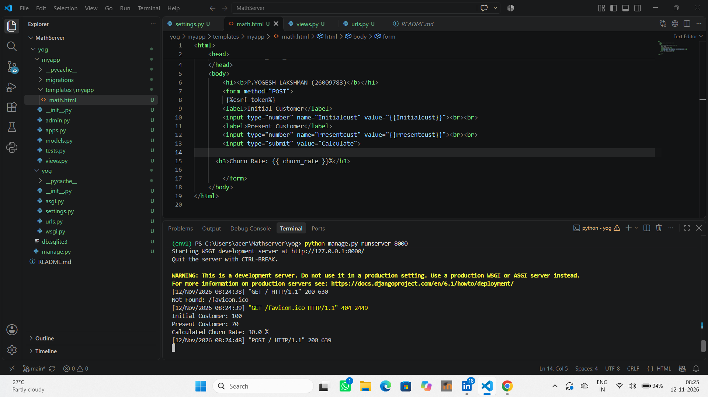
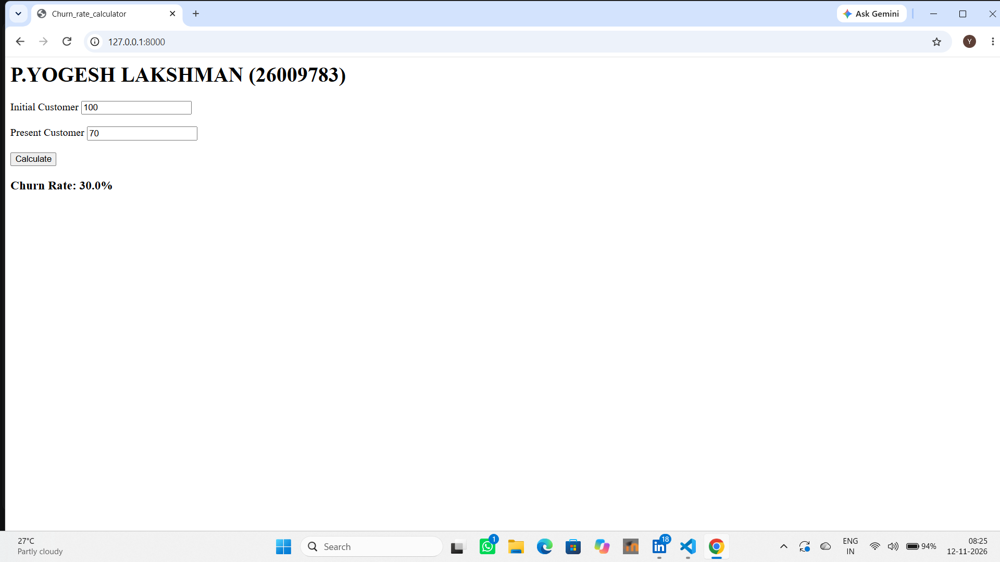

# Ex.03 Design a Website for Server Side Processing
## Date:12.11.26

## AIM:
To create a web page to calculate Churn Rate using server-side scripts.

## FORMULA:
Churn Rate = (CustLost / InitCust) * 100
<br> InitCust --> Initial Customers Count
<br> CustLost --> Customers Lost Count

## DESIGN STEPS:

### Step 1:
Clone the repository from GitHub.

### Step 2:
Create Django Admin project.

### Step 3:
Create a New App under the Django Admin project.

### Step 4:
Create a HTML file to implement form based input and output.

### Step 5:
Create python programs for views and urls to perform server side processing.

### Step 6:
Receive input values from the form using request.POST.get().

### Step 7:
Calculate the Result using the given formula.

### Step 8:
Display the calculated result in the server console.

### Step 9:
Render the result to the HTML template.

### Step 10:
Publish the website in Localhost.

## PROGRAM:
views.py
```

from django.shortcuts import render

def calculate_churn_rate(request):
    context = {}
    
    if request.method == "POST":
        initial_str = request.POST.get("Initialcust", "0")
        present_str = request.POST.get("Presentcust", "0")
        
        Initialcust = int(initial_str) if initial_str else 0
        Presentcust = int(present_str) if present_str else 0
        print("Initial Customer:",Initialcust)
        print("Present Customer:",Presentcust)
        
        if Initialcust > 0:
            churn_rate = ((Initialcust - Presentcust) / Initialcust) * 100
        else:
            churn_rate = 0
            
    
        print("Calculated Churn Rate:", round(churn_rate, 2), "%")
            
        context = {
            "Initialcust": Initialcust,
            "Presentcust": Presentcust,
            "churn_rate": round(churn_rate, 2),
        }
            
    return render(request, "myapp/math.html,context)
```

urls.py
```
from django.contrib import admin
from django.urls import path
from myapp import views

urlpatterns = [
    path('admin/', admin.site.urls),
    path('',views.calculate_churn_rate,name="calculate_churn_rate")
]
```


math.html

<html>
    <head>
        <title>Churn_rate_calculator</title>
    </head>
    <body>
        <h1><b>P.YOGESH LAKSHMAN (26009783)</b></h1>
        <form method="POST">
         
        <label>Initial Customer</label>
        <input type="number" name="Initialcust" value="{{Initialcust}}"><br><br>
        <label>Present Customer</label>
        <input type="number" name="Presentcust" value="{{Presentcust}}"><br><br>
        <input type="submit" value="Calculate">
    
      <h3>Churn Rate: {{ churn_rate }}%</h3>

        </form>
    </body>
</html>


## OUTPUT - SERVER SIDE:


## OUTPUT - WEBPAGE:


## RESULT:
The the web page to calculate Churn Rate using server-side scripts is created successfully.
